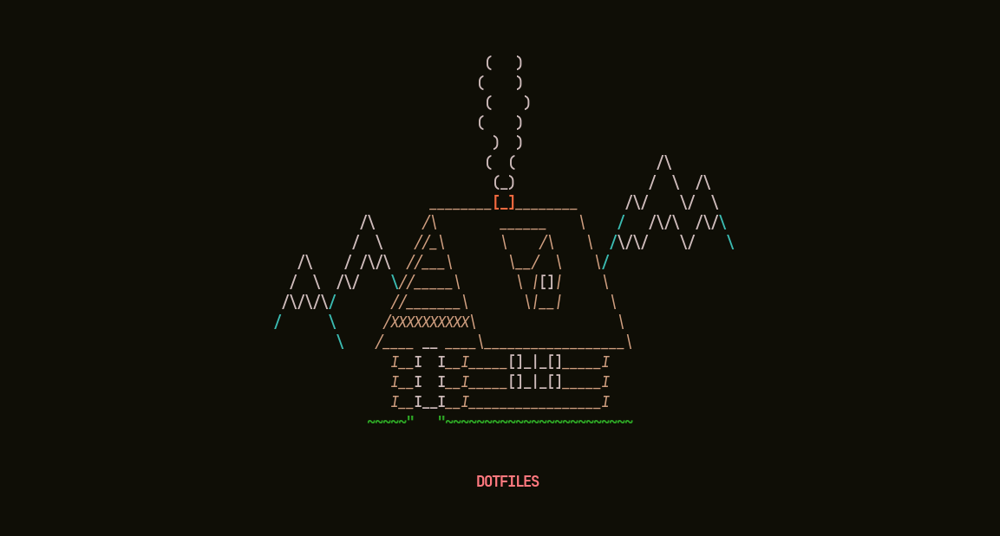
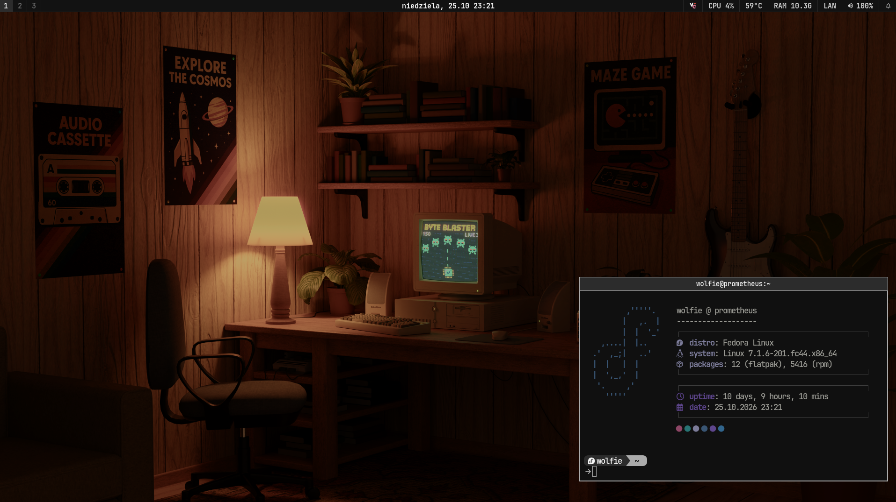

 

_My very personal configuration of my very personal dotfiles_

> Yeah, that image is a screenshot of my Neovim dashboard.

## 📂 Managed with GNU Stow

These dotfiles are managed using **GNU Stow**, which automatically creates symbolic links from your home directory pointing to the repository.
Sick tool, I recommend using it very much.

## Declarative System Provisioning (Ansible)

To achieve reproducible and idempotent system provisioning (inspired by NixOS package management, but on Fedora), package installation, third-party repositories, and Flatpaks I've automated them via **Ansible**.

See [`ansible/README.md`](ansible/README.md) for full docs and architecture details if you are curious soul.

## 📸 Screenshots

Since I'm using `sway` most of the time I don't even see my wallpaper. Very often I see just my terminal (shoutout [`ghostty`](https://ghostty.org/)!)

I've used multiple configurations, some of them ~are~ [were](https://github.com/szymonwilczek/dotfiles/blob/373c046154e8dd032a163467e3dd7f5c8be27ca8/README.md) listed down below. \
Current one is at the very top of the very bottom of that README:

#### Sway (Current)

